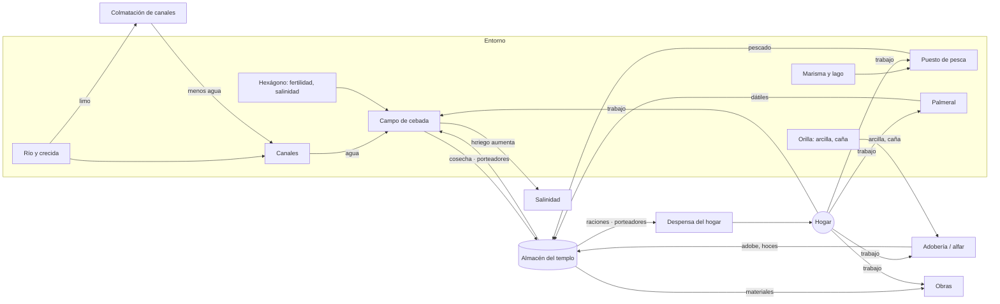
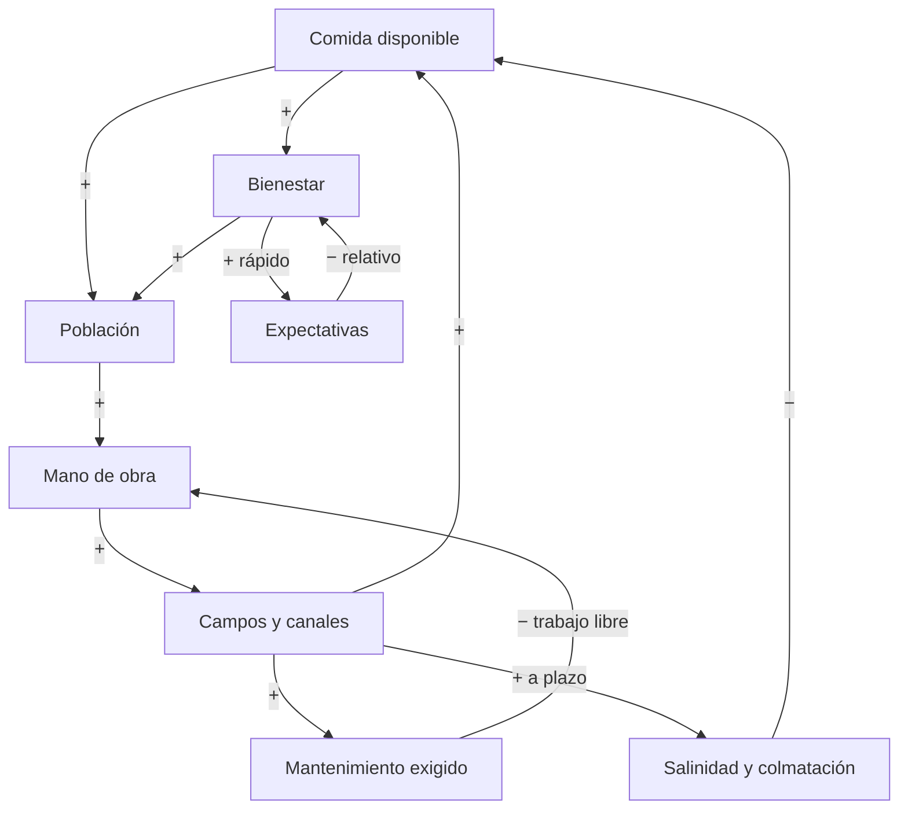

# Entregable C — Modelo de simulación

Cómo se afectan los recursos, las personas, los edificios, los grupos y las civilizaciones. Los números de la v0.1 son **valores iniciales de diseño [D]**: pasarán a `src/data/tuning.json` y se ajustarán con simulaciones headless.

---

## 1. Mapa de flujos de la v0.1 (lo que se mueve físicamente)



**Regla de oro:** las flechas con «porteadores» son agentes visibles con una carga concreta. Si no hay porteadores, la cosecha se queda en el campo y la ración no llega, aunque el almacén esté lleno.

## 2. Bucles causales (por qué nunca es cómodo)



- **R1, crecimiento (refuerza):** comida → gente → trabajo → campos → comida.
- **B1, desgaste de la tierra (equilibra):** más campos regados → más salinidad → menos rendimiento por hexágono.
- **B2, mantenimiento (equilibra):** más infraestructura → más trabajo fijo → menos trabajo para crecer.
- **B3, expectativas (equilibra):** prosperidad → listón más alto → el mismo nivel de vida satisface menos.
- **Choque externo:** la crecida golpea R1 en un punto aleatorio pero pronosticable. Las reservas son el colchón, y cuestan trabajo de hoy.

Con R1 contra B1, B2 y B3, el jugador nunca llega a un punto fijo cómodo: para mantenerse tiene que **cambiar de estrategia** (expandirse, rotar campos, hacer reformas y, más adelante, comerciar o conquistar).

## 3. Reglas y fórmulas de la v0.1

Unidades: **1 ración** = alimento de 1 persona durante 1 día. Hay registros históricos de raciones mensuales de cebada distintas para hombres, mujeres y niños (en Ur III son habituales 60 *sila* al mes para un trabajador varón) [H]. **[D]** El juego usa una ración media por persona para simplificar.

### 3.1 Agricultura
```
cosecha(hexágono) = rindeBase × fertilidad × factorAgua × factorSal × factorHoz × trabajoAportado
factorSal  = max(0, 1 − 1.4 × salinidad)          // la cebada tolera más sal que el trigo [H agronómico]
factorAgua = min(1, aguaRecibida / aguaNecesaria) // desde canales con capacidad > 0
factorHoz  = 1 si hay hoces disponibles, 0.6 sin ellas
```
- **Un campo = 1 hexágono con 2 puestos.** `rindeBase` = 2 400 raciones por hexágono y año, unas 1 200 por campesino: **alimenta a unas 3,3 personas** con todo a favor. Con valores medios reales (fertilidad 0,8, sal 0,15, agua 0,9) alimenta a unas 2,3. Así se reproduce que la mayoría trabaja la tierra [H en sentido amplio].
- **Salinidad:** +0,04 por cosecha regada; +0,03 extra si el hexágono se encharca en la crecida; −0,05 por año en barbecho. Rango [0, 1]. Con 0,7 el hexágono deja de rendir.
- **Ciclo:** siembra en el mes 7 (exige agua en los meses 7–12) y cosecha en el mes 1. La cosecha que no se recoge antes de la crecida se pierde por hexágonos.

### 3.2 Agua y crecida
```
picoAnual ~ Normal(μ = 1.0, σ = 0.35), recortado a [0.2, 2.2]
pronóstico(mes m) = picoAnual + ruido ~ Normal(0, σf(m)),   σf: 0.40 en el mes 10 → 0.10 en el mes 1
inundado(hexágono) si picoAnual × alturaCrecida > elevación + altura del dique en ese hexágono
capacidadCanal -= 0.25 por año (limo);  dragar un tramo = 3 personas-día → capacidad = 1
```
- **Pico < 0,6: sequía.** Los canales no llevan agua suficiente → `factorAgua` baja en los hexágonos lejanos.
- **Pico > 1,5: inundación.** Pierde la cosecha en pie, daña casas y depósitos (−50 % del contenido de un almacén inundado) y bloquea caminos durante 10–20 días.
- Las cifras son de diseño [D]. La irregularidad del Tigris y el Éufrates frente al Nilo es histórica [H].

### 3.3 Hogares: necesidades, bienestar y expectativas
Necesidades de la v0.1 y su satisfacción `s ∈ [0, 1]`:

| Necesidad | Peso | `s` = |
|---|---|---|
| Comida | 0,45 | raciones recibidas / necesarias (media de 30 días) × bonus de variedad (1 + 0,1 por tipo extra, máx. 1,2) |
| Agua | 0,15 | 1 si hay agua dulce a ≤ 3 hexágonos; cae linealmente hasta 0 a 8 |
| Vivienda | 0,25 | choza de caña 0,5 · casa de adobe 0,85 · hacinamiento (> 8 por casa) × 0,6 |
| Salud | 0,15 | 1 − riesgo (marisma cercana, hambre reciente, hacinamiento) |

```
bienestar B = Σ peso × s                          // 0..1
expectativa E: si B > E → E += (B − E) / 60 por día  (sube rápido)
               si B < E → E += (B − E) / 240 por día (baja despacio)
ánimo A = (B − E) + 0.3 × (seguridad − 0.5)
seguridad = min(1, (despensa + parteReservasTemplo) / (consumo × 60 días))
```
**Efecto de la asimetría:** tras un año bueno, el mismo trato se vive como un empeoramiento. Es la mecánica central de «nunca cómodo» y tiene sentido psicológico (adaptación hedónica [I, psicología moderna aplicada como diseño]).

### 3.4 Demografía (se evalúa por mes)
```
nacimientos/mes  = adultos × 0.004 × clamp(B / 0.6, 0, 1.3)
muertes/mes      = personas × (0.0015 + 0.02 × hambreSevera + 0.01 × enfermo)
emigra(hogar)    si A < −0.25 durante 60 días seguidos → p = 0.3/mes; se va con su despensa
inmigran/mes     = round(atractivo × 1.5)   si A_medio > 0.05 y hay vivienda libre
```

### 3.5 Construcción y trabajo
```
obra: etapas = cimientos (10 %) → materiales (todos entregados) → trabajo (personas-día) → terminada
progreso/día = constructores presentes × eficiencia(herramientas, salud)
```
- Si falta un material, la obra queda en `esperando:<material>`. Si faltan brazos, queda en `sin-trabajadores`. **Ese estado es lo que enseña el inspector.**
- **Asignación de trabajo:** los edificios tienen puestos y prioridad (1–5). Cada día se cubren los puestos por prioridad con los adultos libres más cercanos. Los acarreos son tareas en una cola por prioridad; las coge el porteador libre más cercano.

## 4. Modelos de versiones posteriores (diseño, no implementados)

### 4.1 Agravios y estabilidad (v0.2)
```
agravio = { grupo, tipo, magnitud, fecha, vidaMedia, causa }   // causa → enlace a la crónica
peso(t) = magnitud × 0.5^((t − fecha) / vidaMedia)
presión(grupo)    = Σ peso + max(0, E − B) × tamaño
contención(grupo) = legitimidad + coerción × 0.5 + esperanza
escalada si presión / contención supera: 1.0 queja · 1.5 protesta · 2.0 huelga · 3.0 disturbio · 4.0 rebelión
```
Vidas medias de ejemplo: ración recortada 1 año · leva de trabajo 1,5 años · promesa rota 3 años · represión con muertos 8 años (y también *baja* la presión a corto plazo vía coerción). **Reprimir funciona hoy y se paga después.**

### 4.2 Precios (v0.3)
```
precio = precioRef × (demanda / oferta)^0.7, suavizado: p_t = p_{t−1} + (precio − p_{t−1}) × 0.1
oferta = stock en mercado + llegadas previstas (30 días) · demanda = consumo esperado (30 días)
```
Los impuestos y las tasas se cobran sobre transacciones o producción **reales**. El tesoro solo crece si hay actividad: el dinero no aparece de la nada.

### 4.3 Facciones (v0.3)
```
apoyo(f) = Σ_i peso_f,i × variable_i + Σ memoria_f (agravios y favores con decaimiento)
poder(f) = riqueza + miembros × organización + armas + sanción religiosa
```
Acciones de facción por umbral de apoyo × poder: pedir → presionar → bloquear ley → retirar apoyo → financiar protesta → conspirar.

### 4.4 Decisión de la IA rival (v0.4)
```
utilidad(acción) = beneficioEsperado × P(éxito | lo que SABE y SOSPECHA) − coste − riesgo × aversión
memoria(relación) = Σ eventos × confianza × decaimiento   // tratado roto: −40, vida media 20 años
```
La IA actúa sobre **su estimación** del jugador (alimentada por comercio, embajadas y espías), no sobre el estado real.

## 5. Arquitectura de la simulación

### 5.1 Tick y frecuencias (deterministas)
| Sistema | Frecuencia (a ×1) | Qué hace |
|---|---|---|
| Agentes (movimiento, tareas) | cada frame de simulación (20 Hz fijo) | Avanza por la ruta (A* sobre el grafo de hexágonos, coste por terreno y pendiente), recoge o entrega. |
| Trabajo y obras | 1 vez al día | Asigna puestos, aporta progreso, crea tareas de acarreo. |
| Consumo y raciones | 1 vez al día | Despensas, reparto y hambre. |
| Necesidades, bienestar, expectativas | 1 vez al día | Fórmulas §3.3. |
| Agricultura y agua | 1 vez al día (eventos de estación por mes) | Riego, crecimiento, cosecha y crecida. |
| Demografía, emigración | 1 vez al mes | Fórmulas §3.4. |
| Salinidad, colmatación | 1 vez al año (y por evento) | Fórmulas §3.1–3.2. |
| (v0.3+) Facciones, leyes | cada 10 días | Apoyo, acciones. |
| (v0.4+) IA de civilizaciones | 1 vez por estación | Utilidad y diplomacia. |

`×2` y `×4` ejecutan más pasos fijos por frame. El render **interpola y nunca decide nada**: con el render apagado, la partida da exactamente el mismo resultado.

### 5.2 Contratos entre sistemas
- **Estado único serializable** (objetos planos y arrays tipados para los agentes), sin clases con lógica escondida. Así es trivial guardar, probar y portar.
- Los sistemas son **funciones** `sistema(estado, dt, rng) → hechos[]`. No se llaman entre sí.
- **Hechos** = registro causal: `{ tipo: 'racion-recortada', dia, hogar, cantidad, causa: 'reserva<30d' }`. La crónica, el inspector, los agravios (v0.2) y los tests leen los hechos. Ese es el mecanismo del «¿por qué?».
- **RNG con semilla por sistema**, para que añadir un sistema no cambie el azar de los demás.

### 5.3 Niveles de detalle (escalado futuro)
| Nivel | Dónde | Cómo |
|---|---|---|
| **L0 individual** | Ciudad que se mira | Agentes visibles con tareas reales (v0.1). |
| **L1 hogar** | Toda ciudad propia | Hogares sin agentes: el acarreo se resuelve por distancia × capacidad de porteadores. Mismas fórmulas. |
| **L2 agregado** | Ciudades lejanas o rivales | Población por grupo, stocks y flujos mensuales. Mismas fórmulas de bienestar y agravios sobre medias. |

**Invariante de prueba:** una ciudad simulada 5 años en L0 y en L1 debe dar resultados en un margen del ±10 % (test de coherencia entre niveles).

## 6. Cómo se prueba el modelo
- **Unitarios** de cada fórmula (casos límite: almacén vacío, 0 porteadores, salinidad 1, crecida máxima).
- **Determinismo:** misma semilla + mismas órdenes → mismo estado tras 10 años (hash del estado).
- **Bandas de balance (headless, 20 años):**
  - Ciudad *pasiva* (sin órdenes tras el arranque): **debe** decaer, pero no morir antes del año 3.
  - Ciudad con *guion competente*: debe llegar a pueblo en 4–8 años y sufrir al menos una crisis (ánimo medio < 0) en 10 años.
  - Ninguna estrategia de guion debe quedarse 5 años con el ánimo > 0,3 sin cambiar nada (**test de no comodidad**).
- **Rendimiento:** escenario sintético de 500 agentes → tick < 4 ms de media a ×4, medido con `shot`.
